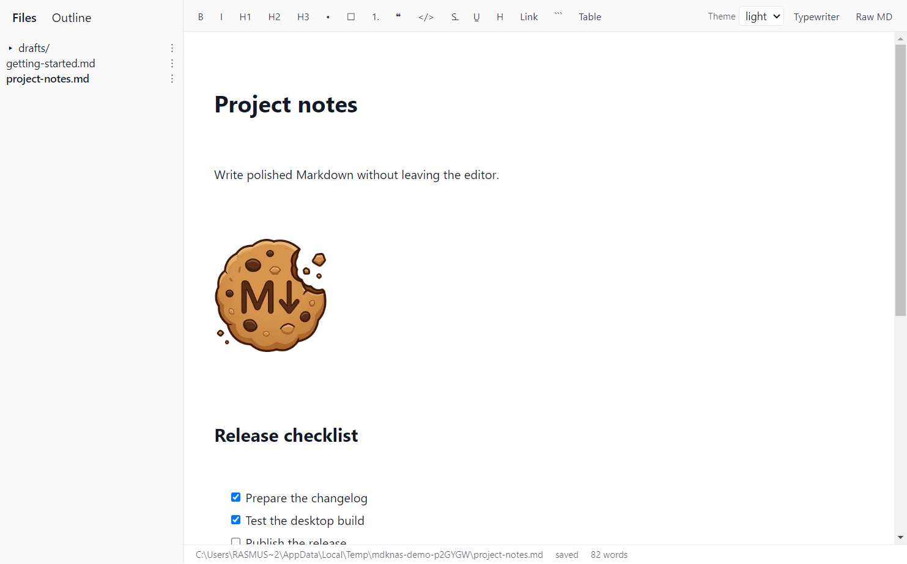
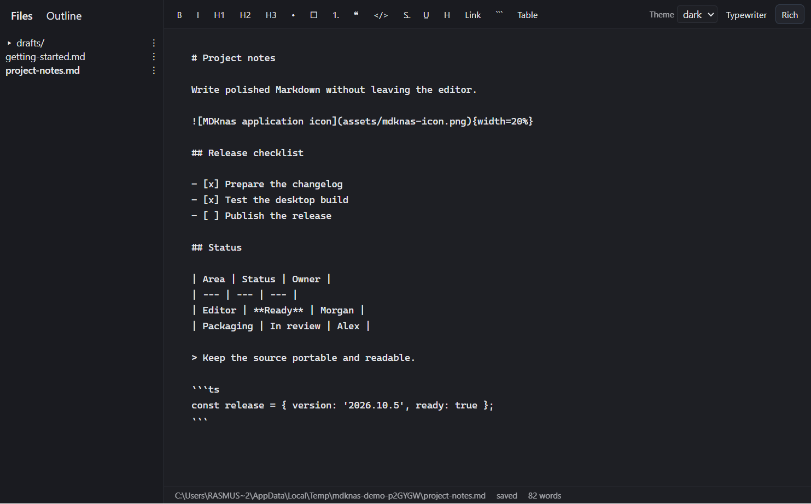
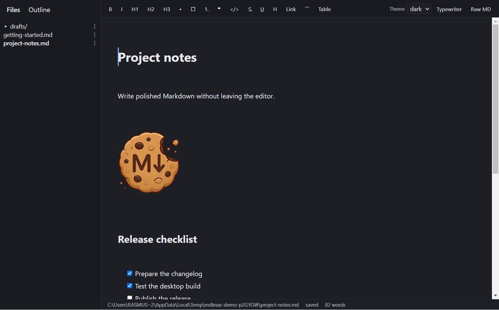

# MDKnas

MDKnas is a desktop WYSIWYG Markdown editor built with Tauri (Rust), React, and
Vite. It keeps Markdown as the source of truth while providing a rich editing
experience for common document structures.

## Features

- Rich editing for headings, emphasis, inline and fenced code, links, quotes,
  lists, task lists, and tables
- Toggleable raw Markdown source view
- File explorer and document outline, with folder watching and remembered last
  folder
- Autosave, undo/redo, and external-file-change detection
- Light, dark, and custom themes
- Syntax highlighting, KaTeX math, Mermaid diagrams, and image resizing
- Paste or drag images into a document's `_assets` folder

## Screenshots

### WYSIWYG editing



### Markdown source



### Dark mode and inline images



## Getting started

Prerequisites:

- Node.js 20 or later
- npm

Install dependencies and start the development app:

```bash
npm install
npm run dev
```

## Commands

| Command | Purpose |
| --- | --- |
| `npm run dev` | Start the Tauri app with Vite hot reload |
| `npm run build` | Build the app with Tauri |
| `npm test` | Run Vitest unit tests |
| `npm run lint` | Type-check the renderer |
| `npm run dist` | Build Linux AppImage and Debian packages |
| `npm run dist:win` | Build the Windows executable (`src-tauri\target\release\mdknas.exe`) |

## Project structure

```text
src/                 React renderer and editor implementation
src/lib/             Markdown rendering, cursor mapping, and text actions
src/tauriApi.ts      window.api bridge to the Rust commands
src-tauri/           Rust backend (Tauri): files, dialogs, menus, settings
msix/                Microsoft Store (MSIX) packaging
tests/unit/          Vitest unit tests
build/               Application icons
```

The Markdown string and its selection are the editor's source of truth. Rich
editing is rendered from that string; editor actions produce updated Markdown
and a new selection rather than mutating document content in the DOM.

## Releases

Version numbers are the build date plus a running number for the day: `YYYY.M.D-N` (e.g. `2026.12.1-1`; older releases are plain `YYYY.M.D`). The GitHub release tag uses a dot for that build number (`v2026.12.1.1`) so AppImages and exes from 2026.11.19–2026.11.25, which only split the tag on `.`, still see it as newer. For a release, update
`version` in `package.json`, `src-tauri/Cargo.toml` and
`src-tauri/tauri.conf.json`, and add matching `Features` and `Fixes` sections
to `CHANGELOG.md`. Pushing the version change to `master` builds Linux
(AppImage, deb) and Windows (exe, unsigned MSIX for the Microsoft Store) via
GitHub Actions and attaches them to a GitHub release. See `STORE.md` for Store
publishing.

`CHANGELOG.md` is bundled with the application and displayed in **Help →
About**.

## License

[MIT](LICENSE)
